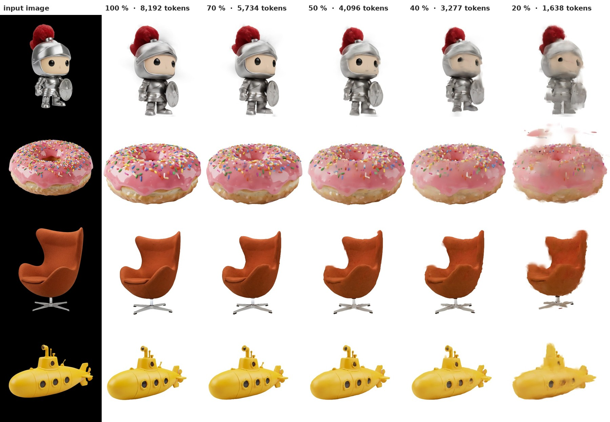

<p align="center">
  <picture>
    <source media="(prefers-color-scheme: dark)" srcset="docs/assets/brand/budget3d_dark.svg">
    
  </picture>
</p>

<p align="center">
  🌐 <a href="https://budgetany.github.io/budget3d/"><b>Project page</b></a> &nbsp;|&nbsp;
  📄 Tech report (coming soon) &nbsp;|&nbsp;
  📄 <a href="https://arxiv.org/abs/2610.12307">BudgetPix paper</a> &nbsp;|&nbsp;
  🤗 <a href="https://huggingface.co/BudgetAny">Models</a> &nbsp;|&nbsp;
  🧩 <a href="https://budgetany.github.io/">BudgetAny</a>: <a href="https://github.com/BudgetAny/BudgetPix">BudgetPix</a> · Budget3D · <a href="https://budgetany.github.io/budgetlatent/">BudgetLatent</a>
</p>

-----

**Budget3D** brings compute-adaptive tokenization to image-to-3D generation. It fine-tunes
[Idol](https://huggingface.co/speridlabs/idol) and [Idol-turbo](https://huggingface.co/speridlabs/idol-turbo), which turn
one image into 3D Gaussian splats, so that one checkpoint runs at any token budget: the regions where the latent varies
least, empty space first, are merged into coarser tokens, and the full-resolution tokens go where it varies most.

> **Unofficial, open-source implementation.** Budget3D is part of [BudgetAny](https://budgetany.github.io/) and is based on
> the method of [BudgetPix: Compute-Adaptive Tokenization for Pixel-Space Image Diffusion](https://arxiv.org/abs/2610.12307)
> (Kara et al., 2026), which it extends beyond the paper to image-to-3D generation. It is not an official release. Thanks
> to the BudgetPix authors for the method.

<p align="center"></p>
<p align="center"><em>One checkpoint, any budget: the same input image, noise and camera at decreasing token budgets.</em></p>

## 🔥 News

- **Nov 2026:** Budget3D joins [BudgetAny](https://budgetany.github.io/), next to [BudgetPix](https://github.com/BudgetAny/BudgetPix) and [BudgetLatent](https://budgetany.github.io/budgetlatent/) (coming soon), with code and weights for Idol and Idol-turbo. The tech report is coming soon.

## 📦 Models

| Model | Base model | Task | Weights |
|---|---|---|---|
| Budget3D-Idol | [Idol](https://huggingface.co/speridlabs/idol) | Image-to-3D | 🤗 [BudgetAny/Budget3D-Idol](https://huggingface.co/BudgetAny/Budget3D-Idol) |
| Budget3D-Idol-Turbo | [Idol-turbo](https://huggingface.co/speridlabs/idol-turbo) | Image-to-3D, few steps | 🤗 [BudgetAny/Budget3D-Idol-Turbo](https://huggingface.co/BudgetAny/Budget3D-Idol-Turbo) |

## 🚀 Usage

#### Installation

Python 3.10+ and a CUDA GPU.

```bash
git clone https://github.com/BudgetAny/Budget3D && cd Budget3D
git clone https://github.com/speridlabs/idol-sdk third_party/idol-sdk      # Idol's model code
pip install -r requirements.txt -r third_party/idol-sdk/requirements.txt
python scripts/convert_dinov3_to_hf.py --model-name vith16plus_lvd1689m --save-dir weights/dinov3   # Idol's image encoder, converted once
```

#### Download the weights

```bash
hf download BudgetAny/Budget3D-Idol budget3d_idol.safetensors --local-dir weights
hf download BudgetAny/Budget3D-Idol-Turbo budget3d_idol_turbo.safetensors --local-dir weights
# Idol's own weights are downloaded from speridlabs on first use
```

#### Sample

`--budget` is the fraction of the tokens to use; `--mode real` uses Idol's crop for photographs.

```bash
python scripts/sample.py --ckpt weights/budget3d_idol.safetensors --image photo.jpg --budget 0.5 --out photo.ply    # 3D Gaussians (.ply)
python scripts/sample.py --ckpt weights/budget3d_idol_turbo.safetensors --turbo --image photo.jpg --budget 0.5 --out photo_turbo.ply
```

## 📚 Citation

Tech report coming soon. Until then, please cite the BudgetPix paper, whose method it builds on:

```bibtex
@article{kara2026budgetpix,
  title={BudgetPix: Compute-Adaptive Tokenization for Pixel-Space Image Diffusion},
  author={Ozgur Kara and Yujia Chen and Daniel Watson and David Forsyth and James Matthew Rehg and Wen-Sheng Chu and Du Tran},
  journal={arXiv preprint arXiv:2610.12307},
  year={2026}
}
```

## 📄 License

The code is released under the MIT License ([`LICENSE`](LICENSE)). The Budget3D weights are fine-tuned from
[Idol](https://huggingface.co/speridlabs/idol) and [Idol-turbo](https://huggingface.co/speridlabs/idol-turbo) (Apache-2.0)
and are released under Apache-2.0 as well. DINOv3 and the FLUX.2 VAE, which the models also need, are not part of this
release and come with their own licenses.

## 🙏 Acknowledgements

Budget3D builds on [Idol](https://huggingface.co/speridlabs/idol) and [Idol-turbo](https://huggingface.co/speridlabs/idol-turbo)
by Sperid Labs, whose model code it imports unmodified, on [DINOv3](https://github.com/facebookresearch/dinov3) and the
[FLUX.2](https://huggingface.co/black-forest-labs) VAE, and on the [Dome-Objaverse](https://huggingface.co/datasets/zeyuanyin/Dome-Objaverse)
renders of [Objaverse](https://objaverse.allenai.org/).

We acknowledge the compute support of the Health Care Engineering Systems Center within the Coordinated Science Lab at UIUC.
